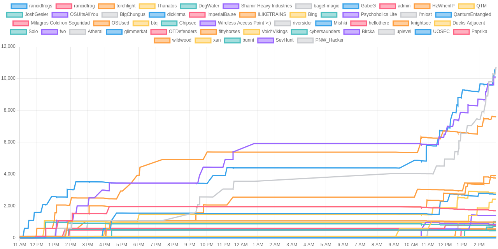

# BSidesPDX CTF 2026

Thank you for playing in BSidesPDX CTF 2026! 

These challenges were deployed on DigitalOcean Kubernetes using [BeaverCDS](https://github.com/osusec/beavercds-backend).

Thank you to our challenge authors:

- Allison Naaktgeboren
- Casey Colley
- Evan Johnson
- Kees Cook
- Shay Cichocki
- Alex Yancey
- Robert Detjens
- Seattle Locksport

And thank you to all of the volunteers who helped run these challenges day-of! <3

## Challenge Summary

| Challenge Name                          | Category | Final Points | Total Solves |
|-----------------------------------------|----------|--------------|--------------|
| rules                                   | misc     | 100          | 35           |
| Lockpicking 1                           | physical | 356          | 13           |
| Lockpicking 2                           | physical | 379          | 12           |
| In the Library of Mount Angel Abbey     | crypto   | 419          | 10           |
| Hedge Maze 1: A Morning Stroll          | misc     | 419          | 10           |
| Never Hesitate                          | rev      | 419          | 10           |
| survey                                  | misc     | 200          | 10           |
| know-after                              | misc     | 451          | 8            |
| In York Minster                         | crypto   | 464          | 7            |
| Hedge Maze 2: Am I Floating             | misc     | 464          | 7            |
| Broken Tic-Tac-Toe                      | web      | 484          | 5            |
| Passphrase Generator                    | rev      | 484          | 5            |
| Mercury Hollow 1: Incident Intake       | web      | 484          | 5            |
| In the Met Cloisters                    | crypto   | 484          | 5            |
| Order 66                                | crypto   | 491          | 4            |
| Scarlet Wish                            | pwn      | 491          | 4            |
| Mercury Hollow 3: Site Photo            | web      | 491          | 4            |
| DragonBall Zeeprom                      | rev      | 491          | 4            |
| Mercury Hollow 2: Soil-Core Export      | web      | 491          | 4            |
| Broken                                  | web      | 496          | 3            |
| 2026 Shamir Secret Share Scavenger Hunt | misc     | 496          | 3            |
| The PDX Print Shop                      | rev      | 496          | 3            |
| Mercury Hollow 4: JANUS Console         | web      | 499          | 2            |
| my\[space\]bf                           | misc     | 499          | 2            |
| Amateur Hour                            | web      | 499          | 2            |
| Hedge Maze 3: Doomed Journey            | misc     | 499          | 2            |
| get it twisted                          | crypto   | 499          | 2            |
| limited edition                         | physical | 499          | 2            |
| Mercury Hollow 5: Final Report          | web      | 499          | 2            |
| Lockpicking 3                           | physical | 500          | 1            |
| Lockpicking 4                           | physical | 500          | 0            |
| mostly-for-appearances                  | web      | 500          | 0            |

## Scoreboard

| Place | Team                      | Score |
|-------|---------------------------|-------|
| 1     | bagel-magic               | 10739 |
| 2     | UOSEC                     | 10559 |
| 3     | OSUItsAllYou              | 10095 |
| 4     | ILIKETRAINS               | 7599  |
| 5     | wildwood                  | 3908  |
| 6     | torchlight                | 3752  |
| 7     | btq                       | 2820  |
| 8     | dickinma                  | 2743  |
| 9     | QTM                       | 2429  |
| 10    | rancidfrog                | 1705  |
| 11    | Psychoholics Lite         | 1402  |
| 12    | Solo                      | 1035  |
| 13    | HzWhenIP                  | 983   |
| 13    | riversider                | 983   |
| 15    | uplevel                   | 938   |
| 16    | Void*Vikings              | 835   |
| 16    | Wireless Access Point >:) | 835   |
| 18    | ImperialBa.se             | 791   |
| 19    | JoshGesler                | 735   |
| 20    | fiftyhorses               | 564   |
| ...   | ...                       | ...   |

### Judge's Choice Awards

**Mercury Hollow:**
- Winner: OSUItsAllYou (only team to full-solve the series)

**Hedge Maze:**
- Winner: OSUItsAllYou (for hand-drawn maps!)

## More Stats :3

We had:
- 49 teams who registered
- 35 teams who completed at least one challenge
- 2 challenge with zero solves
- 186 correct, submitted flags

Thank you again, and see you next year!
